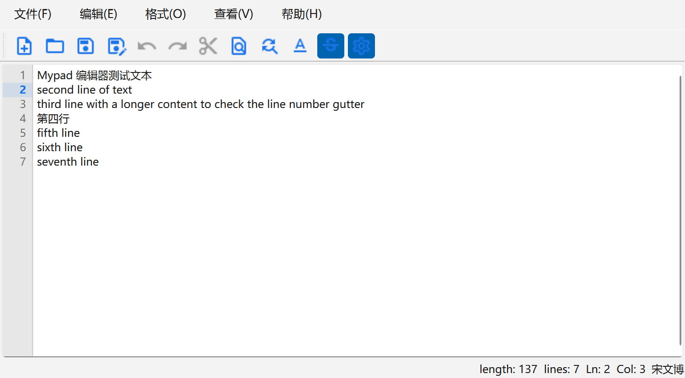
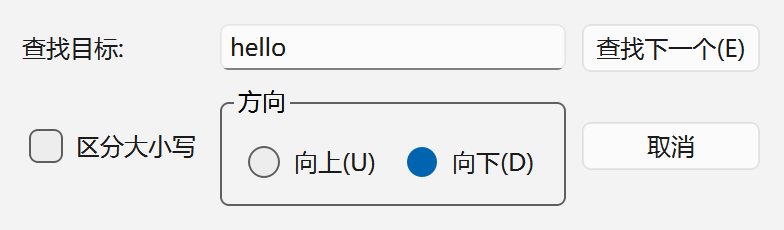
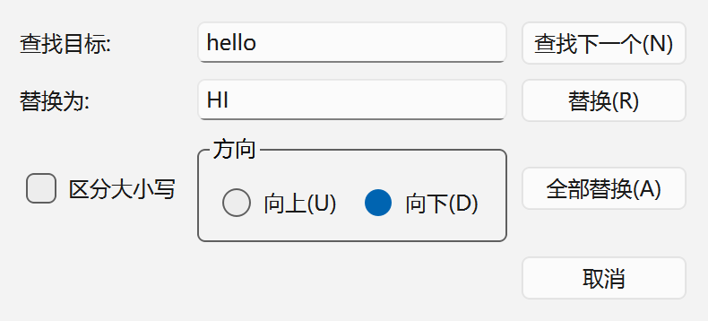

# Mypad

一个用 **Qt 6 + C++（MinGW）** 编写的轻量级 Windows 文本编辑器，界面参考记事本 / Notepad++，
支持新建、打开、保存、另存为、剪贴板操作、查找 / 替换、字体与颜色设置、自动换行、
行号显示，以及带**当前行高亮**的自定义行号编辑控件。

> 课程设计作业项目，代码结构与命名尽量保持简单清晰，方便复习和二次开发。

---

## 界面预览

### 编辑器主界面

行号栏会跟随光标高亮当前行（蓝色加粗 + 淡蓝底色），状态栏实时显示文本长度、行数与光标行列号。



### 查找对话框（Ctrl+F）

支持向上 / 向下查找、区分大小写，找不到时给出提示；到达文档末尾会自动循环查找。



### 替换对话框（Ctrl+H）

支持替换当前匹配、全部替换，全部替换完成后会提示替换数量。



### 关于对话框


---

## 功能列表

### 文件
- 新建（`Ctrl+N`）、打开（`Ctrl+O`）、保存（`Ctrl+S`）、另存为（`Ctrl+Shift+S`）
- 关闭窗口前若内容未保存，会弹出「是 / 否 / 取消」确认框
- 退出菜单项
- 标题栏实时反映当前文件名，未保存时前面带 `*`

### 编辑
- 剪切 / 复制 / 粘贴 / 撤销 / 恢复 / 全选，并带完整快捷键
- 粘贴、复制、剪切、撤销、恢复菜单项**按状态自动启用或禁用**
  （剪贴板为空时禁用粘贴；没有选区时禁用复制与剪切；没有可撤销内容时禁用撤销）
- **查找对话框**：向上 / 向下、区分大小写、循环查找、回车即查找
- **替换对话框**：替换当前、查找下一个、全部替换（带替换数量统计与死循环保护）
- 打开查找 / 替换对话框时，**编辑器里选中的单词会自动填进查找框**（跨行或过长的选区不填充）

### 格式
- 字体设置（`QFontDialog`）
- 字体颜色、编辑器背景色
- 选中文字的字体背景色（高亮）
- 自动换行开关（勾选状态与实际换行模式严格同步）

### 查看
- 显示 / 隐藏 状态栏
- 显示 / 隐藏 工具栏
- 显示 / 隐藏 行号

### 状态栏
- 左侧：文本长度 `length`、段落数 `lines`
- 右侧：光标位置 `Ln: 行号  Col: 列号`，随光标移动实时更新

---

## 快捷键

| 快捷键 | 功能 | 快捷键 | 功能 |
| :--- | :--- | :--- | :--- |
| `Ctrl+N` | 新建 | `Ctrl+F` | 查找 |
| `Ctrl+O` | 打开 | `Ctrl+H` | 替换 |
| `Ctrl+S` | 保存 | `Ctrl+A` | 全选 |
| `Ctrl+Shift+S` | 另存为 | `Ctrl+Z` | 撤销 |
| `Ctrl+X` | 剪切 | `Ctrl+Y` | 恢复 |
| `Ctrl+C` | 复制 | `Ctrl+V` | 粘贴 |

---

## 技术要点

### 1. 自定义可显示行号的文本编辑控件 `CodeEditor`

`CodeEditor` 继承 `QPlainTextEdit`，左侧行号区域是配套的 `LineNumberArea`（继承 `QWidget`，
把绘制事件转发给宿主编辑器）。核心实现：

| 成员 | 作用 |
| :--- | :--- |
| `lineNumberAreaWidth()` | 用**加粗字体**的 `fontMetrics().horizontalAdvance('9')` 估算数字宽度再加边距，保证行数变化时宽度够用 |
| `resizeEvent()` | 按 `lineNumberAreaWidth()` 重新摆放行号区，并设置 `setViewportMargins()` 给行号腾出位置 |
| `updateLineNumberAreaWidth()` | 文档段落数变化时更新宽度 |
| `updateLineNumberArea()` | 内容滚动时按 `dy` 平移重绘行号区 |
| `lineNumberAreaPaintEvent()` | 逐块（`QTextBlock`）绘制行号 |
| `setShowLineNumber(bool)` | 显示 / 隐藏行号（隐藏时宽度归零） |

行号栏的视觉细节：

- 背景沿用编辑器调色板的 `QPalette::Window` 并压暗 5%，因此**「格式 → 背景色」改了以后行号栏会一起变**；
- 右侧一条 1px 半透明分隔线，和正文区做视觉区分；
- **当前行**：整条淡蓝色色带（强调色 `#1A73E8`，与 `img/png/24px_blue` 图标同色系）+ 行号用强调色加粗；
- 其他行号用 `QPalette::WindowText`（alpha 130）弱化，突出当前行；
- 连接 `cursorPositionChanged`，光标换行时行号栏立即重绘。

### 2. 查找 / 替换对话框

- 两个对话框都是**非模态**的 `Qt::Window`，可以和编辑器同时操作；
- 由 `MainWindow` 懒创建并复用（`searchDialog` / `replaceDialog` 指针），再次打开时 `show() + raise() + activateWindow()`；
- 查找逻辑封装在 `findNext()`：先原地查找，失败后把光标移到文档另一端再找一次，实现**循环查找**；
- 替换前先判断当前选区是否就是目标文本（`selectionIsTarget()`），避免「选中了却要先按查找」；
- 全部替换有 `100000` 次上限保护，防止替换文本包含查找文本时无限循环。

### 3. 状态栏行列号

`updateStatusBar()` 在 `textChanged` 与 `cursorPositionChanged` 两个信号里调用：

```cpp
int length = qMax(0, doc->characterCount() - 1);  // characterCount() 末尾多算一个空字符
int lineCount = qMax(1, doc->blockCount());
statusCursorLabel.setText(tr("Ln: %1  Col: %2")
                              .arg(cursor.blockNumber() + 1)
                              .arg(cursor.columnNumber() + 1));
```

### 4. 图标资源

`img/` 下是 Material Icons 的 svg / png（24px、24px_blue、48px 与工具栏专用图标），
通过 `notepad.qrc` 打包进可执行文件；「关于」对话框的 logo 使用 `:/img/png/24px_blue/logo.png`。

---

## 目录结构

```
Mypad/
├── CMakeLists.txt           # CMake 工程（Qt6 Widgets，AUTOMOC/AUTOUIC/AUTORCC）
├── main.cpp                 # 程序入口
├── mainwindow.{h,cpp,ui}    # 主窗口：菜单、工具栏、状态栏、各槽函数
├── codeeditor.{h,cpp}       # 自定义带行号的文本编辑控件 + LineNumberArea
├── searchdialog.{h,cpp,ui}  # 查找对话框
├── replacedialog.{h,cpp,ui} # 替换对话框
├── aboutdialog.{h,cpp,ui}   # 关于对话框（含 logo）
├── opendialog.{h,cpp,ui}    # 预留（暂未接入）
├── notepad.qrc              # 资源文件
├── img/                     # 图标资源（svg / png）
│   └── png/24px_blue/logo.png
└── docs/img/                # README 用到的界面截图
```

---

## 构建与运行

### 环境

- Qt 6（本项目使用 **6.11.2**，Qt 6.5+ 均可）
- MinGW 13.1.0 64-bit（或 MSVC）
- CMake >= 3.16
- Qt Creator（可选）

### 方式一：Qt Creator

打开 `CMakeLists.txt`，选一个 Kit（如 `Desktop Qt 6.11.2 MinGW 64-bit`），配置后直接构建运行。

### 方式二：命令行

```powershell
# 构建目录请放在纯英文路径下（见下方注意事项）
cmake -S "D:/Mypad" -B "D:/Mypad_build" -G Ninja -DCMAKE_MAKE_PROGRAM=C:/Qt/Tools/Ninja/ninja.exe -DCMAKE_BUILD_TYPE=Debug -DCMAKE_PREFIX_PATH=C:/Qt/6.11.2/mingw_64
cmake --build "D:/Mypad_build"
```

### ⚠️ 中文路径注意事项（踩坑记录）

**源码目录可以带中文，但构建目录不要带中文。** 实测：

| 生成器 | 构建目录 | 结果 |
| :--- | :--- | :--- |
| MinGW Makefiles | 含中文 | ❌ `AutoGen: The info file "...AutogenInfo.json" is not readable`（AUTOMOC 的 json 路径被按本地代码页解码成乱码） |
| MinGW Makefiles | 纯英文但源码含中文 | ❌ `No rule to make target '.../notepad.qrc'`（同样卡在中文路径） |
| Ninja | 含中文 | ❌ `moc: Cannot create ...: No such file or directory` |
| **Ninja** | **纯英文** | ✅ 正常 configure + build |

解决办法：在 Qt Creator 里把构建步骤的生成器改成 **Ninja**，并把构建目录设为英文路径，例如
`D:/Mypad_build/%{FileSystemFriendly:%{Kit:Name}_%{BuildConfig:Name}}`
（该设置保存在被 gitignore 忽略的 `.qtcreator/CMakeLists.txt.user` 里，属于本机配置，不需要提交）。

---

## 已知限制 / 后续计划

- 只支持单文件编辑，没有多标签页
- 打开 / 保存文件按纯文本读取，暂不识别编码（UTF-8 / GBK 自动判断）
- 查找暂不支持正则表达式
- 没有撤销历史面板、语法高亮、打印预览

## 许可

本项目为课程作业，仅用于学习交流。图标来自 [Google Material Icons](https://fonts.google.com/icons)（Apache License 2.0）。
